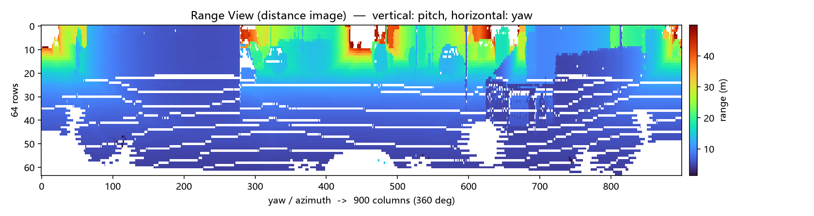

# OverlapMamba RV 投影复现

按 [OverlapMamba](https://arxiv.org/abs/2405.07966)（IEEE RA-L 2025）公式 (5)，
把一帧 LiDAR 点云投影成 **64×900 的距离图（Range View）**，并附数据统计与结果校验。

对应论文：
`OverlapMamba: Novel Shift State Space Model for LiDAR-based Place Recognition`（arXiv:2405.07966）

**这一步不需要 GPU、不需要训练**——纯 CPU 计算，全程约 2 秒。



> 横轴 = 方位角（360° 分 900 列），纵轴 = 俯仰角（64 行），颜色 = 距离（蓝近红远）。
> 底部深蓝是地面，上方橙红色块是远处的建筑与车辆，白色横条是缺失的数据。

---

## 结果概览

| 指标 | 数值 |
| --- | --- |
| 输入 | KITTI odometry seq 00 的一帧点云，126,132 个点 |
| 输出 | 64×900 单通道距离图 |
| 落进网格的点数 | 118,904 |
| 被占据的格子数 | 44,598 / 57,600 |
| 填充率 | 77.43% |
| 运行耗时 | 约 2 秒（CPU） |

**校验**：用几何关系 `距离 ≈ h / sin|仰角|` 反推传感器高度，得 **1.74 m**，
与 KITTI 标准值吻合。详见 [`复现日志.md`](复现日志.md)。

---

## 快速开始

```bash
pip install numpy matplotlib

# 用仓库里已带的一帧真实点云
python rv_projection.py kitti_real_00_000844.bin --outdir out
```

跑完在 `out/` 下得到：

| 文件 | 内容 |
| --- | --- |
| `rv_range.png` | 距离图（主产物） |
| `rv_valid.png` | 有效像素掩码（稀疏度可视化） |
| `report.md` | 点云统计 + 投影统计 + 逐行距离表 |

### 地面校验

`ground_mask.py` 用几何关系 `距离 ≈ h / sin|仰角|` 识别地面：

```bash
python ground_mask.py kitti_real_00_000844.bin --outdir out_ground
```

它先由底部若干行反推传感器高度（得 **1.74 m**），再逐格比对，输出：

| 文件 | 内容 |
| --- | --- |
| `out_ground/ground_overlay.png` | 原图上把「符合地面几何」的格子标红；可见**地面只在下半部分可见，其余被物体遮挡** |
| `out_ground/ground_columns.png` | 四列的「实测距离 vs 地面模型」折线；**两线重合的区段就是地面** |

**该判据的边界**：竖直面在同一行的径向距离为 `X/cos(θ)`，当 `X ≈ h/tan|θ|` 时
与地面数值相同，**在低仰角行无法区分**。所以它适合做"实现是否正确"的校验，
不适合当作精确的地面分割。详见 `复现日志.md` 第 6 节。

---

## 文件说明

| 文件 | 作用 |
| --- | --- |
| `rv_projection.py` | **主脚本**：点云 → 距离图 → 图 + 统计报告 |
| `ground_mask.py` | 地面几何校验，输出识别叠加图与逐列对照 |
| `fetch_first_kitti_scan.py` | 从 KITTI 官方 zip 流式取单帧（**免下载 81 GB**） |
| `复现日志.md` | **复现记录**：环境、参数来源、三项校验、发现并修复的问题 |

数据文件：`kitti_real_00_000844.bin`（真实 KITTI 单帧，1.9 MB）。

---

## 数据是怎么来的

KITTI odometry 的 velodyne 压缩包约 **81 GB**，而跑通这一环只需其中 1 帧（约 1.9 MB）。

`fetch_first_kitti_scan.py` 利用「该压缩包为**无压缩存储**、且 00 序列被放在文件最前面」
这两个特点，**只下载开头 8 MB 就顺序扫描出单帧**：

```bash
python fetch_first_kitti_scan.py --fetch-mb 8 --name 000844.bin
```

想换一帧，改 `--name` 即可（`--fetch-mb` 不够大时脚本会提示）。

> 如果所在网络需要代理，加 `--proxy http://<host>:<port>`。

---

## 关于 AI 工具的使用

本仓库的**代码与全部数值计算由 AI 辅助完成**；参数核对、异常发现、结论判断由本人负责。

这一点在同名文件 [`复现日志.md`](复现日志.md) 的第 0 节有逐项说明，**这是有意写清楚的，不是疏漏**。

---

## 环境

在以下环境验证通过：

| 项 | 版本 |
| --- | --- |
| 操作系统 | Windows 11 |
| Python | 3.14.7 |
| numpy | 2.5.3 |
| matplotlib | 3.11.2 |
| 硬件 | 纯 CPU，未使用显卡 |

依赖只有 `numpy` 和 `matplotlib`，其余为标准库。脚本对中文字体做了回退处理，
在无中文字体的系统上运行不会报错（图内中文可能显示为方块）。
